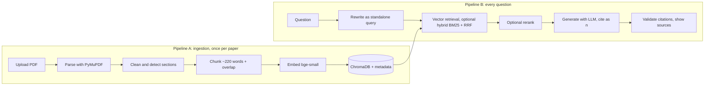

# CiteSure AI

**Trust the evidence behind every citation.**

CiteSure AI is a research-paper assistant built on Retrieval-Augmented Generation (RAG). Upload PDFs, then summarize them, ask questions with verifiable citations, and compare findings across papers. Every answer is grounded in the paper text, and every `[n]` citation is checked in code against the passages that were actually retrieved.

[](https://github.com/AmanGawar/citesure-main/actions)
 

## Why it exists
Reading one paper properly takes hours, and a literature review needs dozens. Pasting a PDF into a general chatbot often gives no page references, invents sources, and breaks on long or multiple documents. CiteSure AI retrieves the exact passages first, answers only from them, and says "I couldn't find that" when the evidence isn't there.

## Features
| Capability | What you get |
|---|---|
| **Ask with citations** | Short answers with numbered references that open the exact passage, section and page. Invalid citations are flagged. |
| **Structured summary** | An approximately 250-word overview split across Problem, Method, Data, Results and Limitations, grounded in retrieved passages. |
| **Paper discovery** | Search OpenAlex by a research topic, view authors and abstracts, and filter to an exact publication year. |
| **Cross-paper comparison** | Pick 2-5 papers and aspects; get a markdown table with citations in each cell. |
| **Grounding guardrails** | Relevance threshold, explicit not-found fallback, citation validation, prompt-injection-aware prompting. |
| **Retrieval upgrades** | Optional hybrid BM25 + vector search (RRF) and cross-encoder reranking are controlled by configuration flags. |
| **Evaluation harness** | Golden set, hit@k, MRR, LLM-judged faithfulness, correct-refusal rate. |
| **Ships properly** | Streamlit UI, FastAPI REST API, pytest suite, GitHub Actions CI, Docker. |

## Architecture


**Stored per chunk:** `chunk_id`, `paper_id` (content hash), `title`, `section`, `page`, text and embedding.

## Quick start
```bash
git clone https://github.com/AmanGawar/citesure-main.git && cd citesure-main
python3 -m venv .venv && source .venv/bin/activate      # Windows: .venv\Scripts\activate
pip install -r requirements.txt
cp .env.example .env                                     # then set GROQ_API_KEY
streamlit run streamlit_app.py
```
The first run downloads the ~130 MB embedding model. Embeddings run locally and for free; only the LLM calls cost money (a few cents while developing). Use open-access papers (for example from arXiv) and do not commit PDFs.

To use the standalone website instead of the Streamlit UI, set `GROQ_API_KEY` in `.env`, then run `uvicorn api:app --reload` and open `http://127.0.0.1:8000`.

### Deploy the standalone website on Render
Create a Render **Web Service** using the Docker runtime so it uses the included Dockerfile (which runs the FastAPI website, not the Streamlit UI). Leave the build and start commands empty; the Dockerfile installs CPU-only PyTorch, caches the embedding model during build, and starts Uvicorn on Render's `$PORT`. Add `GROQ_API_KEY` and, for paper discovery rate limits, `OPENALEX_API_KEY` under the service's environment variables. Configure a persistent disk mounted at `/app/data` if uploaded PDFs and the ChromaDB index must survive restarts or redeploys. The embedding model and vector operations need sufficient memory; upgrade the Render instance if logs show the process being terminated for memory use.

### Docker
```bash
docker compose up --build                       # UI on http://localhost:8501
docker compose --profile api up --build         # also starts the API on http://localhost:8000
```

The standalone paper-discovery web page is served by FastAPI at `http://localhost:8000/`.
The Streamlit app on port 8501 also includes paper discovery, filtered search results,
abstract-based summaries, importing discovered records, and library Q&A/summary/compare workflows.

### REST API
```bash
uvicorn api:app --reload                        # Swagger docs at http://127.0.0.1:8000/docs
curl -F "file=@data/papers/paper.pdf" http://127.0.0.1:8000/papers
curl -X POST http://127.0.0.1:8000/ask -H "Content-Type: application/json" \
  -d '{"question": "What optimizer and learning-rate schedule were used?"}'
```
Endpoints: `POST /papers`, `GET /papers`, `DELETE /papers/{id}`, `POST /ask`, `GET /papers/{id}/summary`, `POST /compare`, and `POST /similar-papers` (send `query`, optional exact `year`, and `limit`).

## Deploy on Streamlit Community Cloud
1. Push this repo to GitHub (the `.env` file and `data/` are git-ignored).
2. Go to [share.streamlit.io](https://share.streamlit.io), choose **New app**, select the repo, branch `main`, and main file `streamlit_app.py`. Set Python to 3.11 under advanced settings.
3. Open **App settings > Secrets** and paste:
   ```toml
   GROQ_API_KEY = "your-key-here"
   ```
4. Deploy. The first boot is slow while the embedding model downloads.

The Streamlit interface provides Ask, Discover, Summarize, and Compare tabs. Discovery
searches OpenAlex, supports year and open-access filters, ranks results semantically,
and lets you summarize or import records with abstracts into your library. Summaries,
Q&A history, and comparisons can be downloaded as Markdown. To increase OpenAlex's
request budget, add `OPENALEX_API_KEY` as another Streamlit secret.
Upload and index PDFs one at a time; the embedding model loads during app startup so
the first upload does not also have to wait for model initialization.

Notes for a public demo:
- **Protect your wallet.** Set a spend limit in your LLM provider console. The app caps each session at `MAX_QUESTIONS` (default 40).
- Streamlit Cloud storage is temporary, so uploaded PDFs and the index may reset when the app restarts.
- `pysqlite3-binary` is installed on Linux to satisfy ChromaDB's SQLite requirement; `streamlit_app.py` swaps it in automatically.
- The free tier has limited memory. If the app runs out, keep `USE_RERANK=false` (the reranker is a second model).

## Configuration
| Variable | Default | Purpose |
|---|---|---|
| `GROQ_API_KEY` | none | Groq LLM access |
| `OPENALEX_API_KEY` | none | Optional OpenAlex API key; increases the discovery request budget |
| `LLM_MODEL` | `qwen/qwen3.8-27b` | Default model used for answers and summaries |
| `EMBED_MODEL` | `BAAI/bge-small-en-v1.5` | Local embedding model |
| `TOP_K` / `MIN_SCORE` | `6` / `0.30` | Chunks sent to the LLM / relevance threshold |
| `CHUNK_WORDS` / `CHUNK_OVERLAP` | `220` / `40` | Chunking |
| `USE_HYBRID` / `USE_RERANK` | `false` / `false` | Enable hybrid BM25 + vector retrieval or cross-encoder reranking. |
| `MAX_QUESTIONS` | `40` | Per-session question cap |

Summary generation is capped at 900 output tokens and repeated paper-summary requests are cached in memory. To reduce first-generation latency further, set `LLM_MODEL` to a faster, smaller model supported by your configured LLM provider. The uploaded-paper summary cache and discovered-paper cache are process-local and clear when the service restarts.

## Evaluation
```bash
python -c "from citesure.store import PaperStore; print(PaperStore().list_papers())"   # find your paper_id values
# edit eval/golden.jsonl: 6-10 answerable questions per paper plus 5-10 unanswerable ones
python eval/run_eval.py
```
`eval/golden.jsonl` is a starter template, not a measured benchmark. Replace every `REPLACE_WITH_PAPER_ID` with an ID from your local library and add evidence snippets from those papers before running the evaluation.
Retrieval is measured by **hit@k** and **MRR**; answers by **LLM-judged faithfulness** and **correct "not found" rate** on unanswerable questions. Change one thing at a time and record it below. These cells are empty on purpose: fill them with your own measured numbers.

| Experiment | Hit@6 | MRR | Faithful | Latency | Takeaway |
|---|---|---|---|---|---|
| Baseline (220 words, bge-small) | - | - | - | - | |
| Chunk size 120 / 400 words | - | - | - | - | |
| Overlap 0 / 40 / 80 | - | - | - | - | |
| bge-base vs bge-small | - | - | - | - | |
| k = 3 / 6 / 10 | - | - | - | - | |
| + Hybrid BM25 + vector | - | - | - | - | |
| + Cross-encoder rerank | - | - | - | - | |
| Without query rewriting (multi-turn) | - | - | - | - | |

A small self-written golden set is easy to overfit and may favor easy phrasing, and an LLM judge is imperfect. Spot-check some verdicts by hand.

## Design decisions
- **Plain Python, no framework:** every step is explicit and explainable.
- **~220-word chunks with 40-word overlap, never crossing sections:** precise but self-contained; tuned with evidence.
- **Local bge-small embeddings, normalized cosine:** free, private, strong on retrieval benchmarks. The BGE query prefix is applied to questions only.
- **ChromaDB:** zero-ops with metadata filtering. FAISS, Qdrant or pgvector are the scale-up path.
- **Facet-based summaries instead of stuffing the whole PDF:** cheaper, citable, and works on long papers.
- **Per-paper retrieval for comparisons:** one long paper cannot crowd out the others.
- **Programmatic citation validation:** cheap, transparent and testable.

## Limitations
- Scanned PDFs have no text layer (OCR is future work).
- Heading detection uses a regex, titles are heuristic, and tables and equations come out as messy text.
- Hyphenated words split at line breaks can be joined wrongly.
- Citation validation checks that a cited number exists, not that the claim is actually true.
- Prompt injection through PDF text is mitigated, not eliminated.

## Project structure
```
citesure/       config, ingest, store, prompts, llm, service, hybrid, rerank
streamlit_app.py   web UI          api.py   REST API
eval/           golden.jsonl, run_eval.py
tests/          test_api_discovery.py, test_ingest.py, test_prompts.py, test_summary.py
.github/workflows/tests.yml   CI   Dockerfile, docker-compose.yml
```
Run the tests with `pytest -q`. API tests mock LLM generation and paper storage so they do not require credentials, paid API calls, or a populated library. The evaluation harness separately measures retrieval and answer quality against your own papers.

## Roadmap
OCR for scans, layout-aware parsing (pymupdf4llm or GROBID), import by arXiv ID, citation graph, caching, observability, per-user libraries.

## License
MIT. See `LICENSE`.
